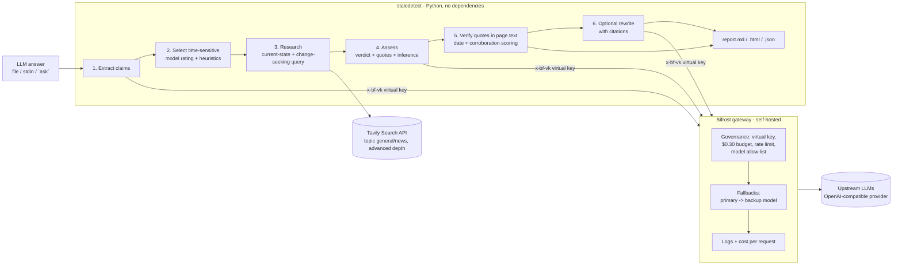
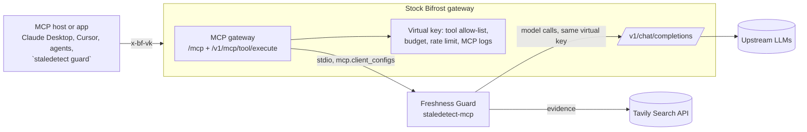

# Stale-Answer Detector

**Geek Room Global AI Hackathon 2026. One product, two problem statements:**

| Track | Problem statement | What answers it |
|---|---|---|
| **Tavily** | 06 · Build a Stale-Answer Detector for AI Applications (challenge 05 in the 1 Nov brief) | `staledetect check` / `ask`: the detector itself (below) |
| **Bifrost by Maxim AI** | 04 · Build a Feature the Open-Source Gateway Is Missing | **Freshness Guard** ([section below](#freshness-guard-a-bifrost-mcp-gateway-feature-bifrost-problem-statement-04)): the detector packaged as an MCP server that plugs into a stock Bifrost gateway, so every agent and app behind the gateway can check answers for stale facts, governed by its virtual key |

Built with **Bifrost by Maxim AI** and **Tavily**. Pitch deck: [`docs/stale-answer-detector-deck.pptx`](docs/stale-answer-detector-deck.pptx) ([PDF](docs/stale-answer-detector-deck.pdf)).

LLMs state facts about prices, API versions, laws and who runs a company with complete confidence, even after those facts have changed. This tool takes an LLM-generated answer, finds the claims that can go out of date, re-checks them against live web sources, and labels each claim **supported**, **changed** or **could not be verified**. Every label comes with a confidence indicator, the date of the newest evidence, and source links.

```
$ staledetect ask "Who is the CEO of X (Twitter), what is the latest stable Python version, and which Node.js release is the current Active LTS?"

--- answer from otari/meta/llama-3.1-8b-instruct ---
1. CEO of Twitter: Parag Agrawal (since November 2021)
2. Latest stable Python version: Python 3.9.9 (released on October 4, 2021)
3. Current Active LTS Node.js release: Node.js 14.17.0 (released on April 26, 2022)

3 claims, 3 re-checked: 0 supported, 3 changed, 0 unverifiable
  CHANGED  0.96  Parag Agrawal is the CEO of Twitter.  -> now: no longer CEO; removed by Elon Musk in 2022 ...
  CHANGED  0.91  The latest stable Python version is Python 3.9.9.  -> now: Python 3.15.1, released on October 21, 2026.
  CHANGED  1.00  Node.js 14.17.0 is the current Active LTS release. -> now: Node.js 24.x ..., Node.js 26 scheduled to become Active LTS on October 28, 2026.
Bifrost: 4 calls, 0 via fallback; Tavily: 5 searches
```

(Real output from 2 November 2026. The full report is in [`examples/run-ask-llama31-8b/`](examples/run-ask-llama31-8b/report.md).)

**Demo video:** [`media/demo.mp4`](media/demo.mp4) (3 min 40 s, 1080p, captions burned in; [`media/demo.srt`](media/demo.srt)). The narration is an AI text-to-speech voice (Microsoft Edge neural TTS, en-IN). Terminal scenes replay the saved outputs of the runs in `examples/`, the test scene is a real `pytest` run, and the report scenes are screenshots of `examples/*/report.html`.

## What the Tavily challenge asks for, and where it is met

| Requirement (Tavily problem statement 06 / brief challenge 05) | How this project meets it |
|---|---|
| Accept an LLM-generated answer and identify factual claims that may be time-sensitive | `staledetect check answer.md` (or `ask` to generate one). The **extract** step, run through Bifrost, splits the answer into atomic claims, each with a category and a time-sensitivity rating. A deterministic heuristic scorer (prices, versions, job titles, laws, "currently/latest", quantities, limits) backs it up, so a claim with a price or a CEO title is never skipped just because the model rated it low. Stable facts ("Python was created by Guido van Rossum") are listed as *not re-checked*. |
| Use live research to re-check selected claims against sources | Two **Tavily** searches per selected claim: one for the current state of the fact, and one *change-seeking* query that looks for news that it changed ("X steps down as CEO", "new version released"). The second query goes looking for disconfirming evidence, so the check isn't biased towards pages that repeat the old fact. Results are de-duplicated and sorted newest first. |
| Assign a freshness or confidence indicator to each claim, with source links | Each claim gets a 0–1 confidence and a high/medium/low level. The score combines the model's confidence with checks the code does itself: how many quotes were verified, how many independent sites agree, and how recent the newest evidence is (a date written inside the quote, like "As of January 2025", counts over the page date). It also records the newest evidence date and links each source. |
| Show which claims remain supported, have changed, or cannot be verified | Markdown, HTML and JSON reports with 🟢 supported / 🔴 changed (plus the current fact) / ⚪ unverifiable. `--rewrite` also produces a corrected answer with numbered citations. |
| "Clearly distinguish evidence from inference" (implementation note) | **Evidence** is only text quoted from a retrieved page, and every quote is checked against that page's text by code. Quotes that don't match are rejected and counted. **Inference** (the model's reasoning) is shown separately and labelled. If a "supported"/"changed" verdict has no verifiable quote, it is downgraded to "unverifiable". A "changed" verdict that adds no new fact, or that rests on a single website, is flagged or capped. |
| "Use Tavily for fresh web research and Bifrost for the model requests that extract, assess, or rewrite claims" | Exactly that split. All model calls (extract, assess, rewrite, and the `ask` answer) go through Bifrost. All research goes through Tavily. |

## Architecture



**What Bifrost does here (and why it matters for this product):**

- **One gateway for three model roles.** Extraction uses a cheap fast model (`qwen3-30b-a3b-instruct`). The harder judging step uses a stronger model (`qwen3-235b-a22b-instruct`). Each role has its own fallback chain. The app never talks to a provider directly.
- **Governance.** The app only holds a Bifrost *virtual key*. That key has a **$0.30 monthly budget**, a **300 requests/day and 400k tokens/day rate limit**, and a **model allow-list**. Bifrost enforces all of this before any provider is called (see [`examples/bifrost-governance-checks.md`](examples/bifrost-governance-checks.md): no key → 401 `virtual_key_required`, model outside the list → 403 `model_blocked`). A fact-checker that loops over many claims is exactly the kind of app that needs a hard spend ceiling.
- **Reliability.** Every request carries `fallbacks`. `--simulate-outage` routes the primary model to a provider entry whose upstream is down, and Bifrost answers from the fallback model. The report shows a warning, and `routing_info.is_fallback` is recorded per call ([`examples/run-outage/`](examples/run-outage/report.md)).
- **Observability and cost.** Pricing overrides give the self-hosted custom provider real per-token prices, so Bifrost's logs and the budget counter show actual spend. The CLI reads `/api/logs` and `/api/governance/virtual-keys` after each run and prints cost, errors and budget used.

**What Tavily does here:** Tavily is the only source of evidence. The detector calls `POST /search` with `search_depth: advanced` and `chunks_per_source: 3`, so it gets the relevant passages rather than whole pages. It uses `topic: news` with `time_range: year` for leadership, events and laws, and `topic: general` for docs and pricing. `include_answer` stays off, so the verdict is based on raw sources and not on a pre-written summary. Results are cached on disk (`.cache/tavily`) to save credits when re-running.

## Setup

Requirements: Python 3.10+, Node.js 18+ (for `npx`) or Docker, a Tavily API key (the free Researcher plan gives 1,000 credits a month), and an API key for any OpenAI-compatible LLM endpoint.

```bash
git clone https://github.com/ridakalam52-design/geekroom-stale-detector
cd geekroom-stale-detector
pip install -e ".[dev]"            # no runtime dependencies; pytest for tests
cp .env.example .env               # fill in TAVILY_API_KEY, OTARI_API_KEY, BIFROST_VK, BIFROST_SETUP_TOKEN

./scripts/run_bifrost.sh           # terminal 1: Bifrost on http://localhost:8080 (npx @maximhq/bifrost)
set -a; . ./.env; set +a           # terminal 2
staledetect doctor                 # checks the gateway, the virtual key and the Tavily key
staledetect check examples/sample_answer.md --rewrite --out runs/sample
open runs/sample/report.html
```

More commands:

```bash
staledetect ask "What does GitHub Copilot cost and who is the CEO of OpenAI?"   # answer with an older model, then check it
staledetect check answer.md --question "..." --max-claims 5                       # cap the live checks (cost control)
staledetect check answer.md --simulate-outage                                     # watch Bifrost fall back
cat answer.txt | staledetect check -                                              # stdin
staledetect guard --answer-file answer.md                                          # Freshness Guard via Bifrost's MCP gateway
python -m pytest -q                                                               # 59 offline tests
```

**Using another LLM provider.** [`bifrost/config.json`](bifrost/config.json) defines one OpenAI-compatible custom provider called `otari` (I used Mozilla's Otari gateway for open-weight models). To use OpenAI, Gemini, Anthropic, Groq or any other provider Bifrost supports, add it under `providers`, add it to the virtual key's `provider_configs`, and set `STALE_MODEL` / `STALE_ASSESS_MODEL` / `STALE_FALLBACKS` to `provider/model` names. `proxy_config: {"type": "environment"}` only makes Bifrost respect `HTTP(S)_PROXY` if your network has one. It does nothing otherwise.

## Sample runs (real, 2 and 4 November 2026)

| Run | What it shows |
|---|---|
| [`examples/run-sample/`](examples/run-sample/report.md) | A 9-claim answer written in the style of an assistant with an older knowledge cutoff. Result: **6 changed** (Python 3.12 → 3.15, Node 20 → 26 Active LTS, GPT-4o → GPT-6 Astra, Linda Yaccarino no longer CEO of X since July 2025, EU AI Act now adopted with obligations applying, Copilot moved to usage-based AI Credits), **1 supported** (Tavily free plan = 1,000 credits/month), **1 unverifiable** (an invented Pune startup: sources only describe other companies called Brightwave, so it is *not* marked "changed"), and **1 stable fact not re-checked**. Includes the corrected answer with 21 cited URLs. 11 Bifrost calls, ~$0.0045. |
| [`examples/run-ask-llama31-8b/`](examples/run-ask-llama31-8b/report.md) | `ask` mode. Llama 3.1 8B (through Bifrost) gives a 2021-era answer, and all 3 claims are flagged as changed with current facts. |
| [`examples/run-outage/`](examples/run-outage/report.md) | `--simulate-outage`: all 4 model calls were served by fallback models, and the report says so. |
| [`examples/bifrost-governance-checks.md`](examples/bifrost-governance-checks.md) | Virtual-key enforcement, model allow-list, fallback routing info, budget and rate-limit counters. |
| [`examples/run-guard/`](examples/run-guard/guard.md) | **Freshness Guard** (4 Nov 2026): the same detector called as MCP tools through a stock Bifrost gateway. 2 changed, 1 supported. |
| [`examples/freshness-guard-gateway-checks.md`](examples/freshness-guard-gateway-checks.md) | Freshness Guard at the gateway: tool discovery per virtual key, 401 without a key, instructions forwarding, tool execution API, MCP logs. |

Each run folder has `report.md` (readable), `report.html` (one self-contained page for the demo) and `report.json` (everything: claims, scores, sources, rejected quotes, gateway stats).

## Freshness Guard: a Bifrost MCP gateway feature (Bifrost problem statement 04)

**The operator problem.** A Bifrost gateway sits in front of many agents and apps. It can cap their spend, route around outages and log every request, but it cannot tell the operator, or the agents themselves, when a model answer coming through it states facts that are out of date. The usual result is that each team builds its own fact-check, if they build one at all. I checked Bifrost's issues and docs on 4 November 2026 (searches: freshness, fact check, stale answer, hallucination) and found no existing feature or open request for answer freshness. Bifrost's guardrails are an Enterprise feature aimed at content and safety policies.

**The feature.** Freshness Guard is an MCP server (`staledetect-mcp`, Python standard library only) that an operator registers once in Bifrost. It uses Bifrost's documented MCP gateway extension point (`mcp.client_configs`) and needs no Bifrost code changes. From then on, every MCP host (Claude Desktop, Cursor, an agent framework) and every app behind the gateway gets two tools through Bifrost's own `/mcp` endpoint and `/v1/mcp/tool/execute` API:

| Tool (name on Bifrost) | What it does | Cost |
|---|---|---|
| `freshness_guard-triage_freshness` | Scores each sentence of an answer for how likely it is to go stale (prices, versions, roles, laws, "currently/latest", quantities, limits) and says whether a live check is worth it | Free: no network, no model call |
| `freshness_guard-check_freshness` | The full detector: claims extracted and judged by models **through the same Bifrost gateway**, evidence from **Tavily**, and a verdict per claim (supported / changed + current fact / unverifiable) with confidence and source URLs | A few model calls + 2 Tavily searches per claim, capped by `max_claims` (1–8) |



**What Bifrost governs here:**

- **Who can use it.** Only virtual keys whose `mcp_configs` list `freshness_guard` can see or call the tools. A request without a virtual key gets `401` ([checks](examples/freshness-guard-gateway-checks.md)).
- **What it costs.** The live check's own model calls go back through Bifrost under the server's virtual key, so the key's **$0.30 budget, 300 requests/day and model allow-list** apply to the fact-checking itself, and fallbacks keep it running through a provider outage.
- **What happened.** Each tool call shows up in Bifrost's MCP logs with tool, server, virtual key, latency and the budget and rate limit attached. The model calls show up in the normal request logs with cost.
- **Agents are told how to use it.** The server's `instructions` (triage first, live check only when it matters, treat "unverifiable" as unknown) are forwarded by Bifrost to every MCP client on `initialize`.
- `client.mcp_disable_auto_tool_inject: true` is set, so the detector's own model calls through the gateway never get MCP tools injected (no loops). Callers opt in per request with `x-bf-mcp-include-tools`.

**Setup on a stock Bifrost** (this repo's `bifrost/config.json` already contains all of it):

```json
"client": { "mcp_disable_auto_tool_inject": true },
"mcp": {
  "client_configs": [{
    "name": "freshness_guard",
    "connection_type": "stdio",
    "stdio_config": { "command": "staledetect-mcp", "args": [],
                      "envs": ["PATH", "HOME", "BIFROST_URL", "BIFROST_VK", "TAVILY_API_KEY"] },
    "auth_type": "none",
    "tools_to_execute": ["*"],
    "tool_execution_timeout": 180
  }]
},
"governance": { "virtual_keys": [{ "...": "...",
  "mcp_configs": [{ "mcp_client_name": "freshness_guard", "tools_to_execute": ["*"] }] }] }
```

```bash
pip install -e .                       # puts staledetect-mcp on PATH for Bifrost to spawn
./scripts/run_bifrost.sh               # Bifrost connects to freshness_guard at startup
staledetect guard --answer-file examples/run-guard/answer.md --max-claims 3
staledetect guard "Who is the CEO of Intel and what is the latest Kubernetes release?"   # ask a model first
staledetect-mcp --http 3001            # optional: Streamable-HTTP server; register it with connection_type "http" (tested with Bifrost v2.4.0)
```

`staledetect guard` is the client side: it never imports the detector. It discovers the tools on Bifrost's MCP gateway with its virtual key, runs the free triage, and calls the live check only when the triage recommends it (or with `--force`).

Two things I learned on Bifrost v2.4.0 and handled: every variable listed in `stdio_config.envs` must be set, or Bifrost refuses to start the client (`environment variable STALE_MODEL is not set`), so the list holds only what the server needs. And Bifrost's default tool timeout is 30 s, while a live check takes 25–35 s, so the client sets `tool_execution_timeout: 180`.

**Live run on a stock Bifrost v2.4.0** (4 November 2026, [`examples/run-guard/guard.md`](examples/run-guard/guard.md)). A Llama 3.1 8B answer, sent through Bifrost's MCP gateway:

| Verdict | Confidence | Claim | Current fact found |
|---|---|---|---|
| CHANGED | 0.96 | Pat Gelsinger has been the CEO of Intel since February 2021 | No longer CEO since 1 December 2024; interim co-CEOs, later Lip-Bu Tan |
| CHANGED | 1.00 | The latest stable Kubernetes release is v1.24 (April 2022) | v1.37, released 26 August 2026 |
| SUPPORTED | 0.93 | ChatGPT Plus costs $20 per month | (unchanged) |

Gateway numbers for that run: 4 model calls through Bifrost, $0.0017 logged cost against the key's $0.30 budget, 0 errors. The gateway-level checks (tool discovery, 401 without a key, instructions forwarding, tool execution API, error handling, MCP logs) are in [`examples/freshness-guard-gateway-checks.md`](examples/freshness-guard-gateway-checks.md).

**Requirements of Bifrost problem statement 04, and where they are met:**

| Requirement | Where |
|---|---|
| Real operator problem, solved end to end | Gateways can't flag stale facts in answers today. Freshness Guard does it at the gateway, for every client, with spend and access under the gateway's control |
| Public extension points | Only Bifrost's documented MCP gateway: `mcp.client_configs` (stdio), virtual-key `mcp_configs`, `/mcp`, `/v1/mcp/tool/execute`, MCP logs. No fork, no patch |
| Works with a standard Bifrost installation, clear setup | Tested against `npx @maximhq/bifrost` v2.4.0 with the config above; setup steps in this section |
| Tests, documentation, PR-ready repository | 33 new offline tests (`tests/test_mcp_server.py`, `tests/test_guard_cli.py`): MCP protocol and version negotiation for Bifrost's three versions, both tools, argument errors, gateway refusals, stdio and HTTP transports, and the shipped Bifrost config. MIT licensed, no runtime dependencies |
| Integrates Tavily | The live check's evidence comes only from Tavily |

What it is not yet: it is an MCP server that plugs into Bifrost, not a Go plugin inside Bifrost. An upstream contribution would most naturally be a docs/example entry (the config above plus the server), or a port of the triage scorer to a Go plugin. I haven't opened a pull request upstream.

## How the confidence indicator is computed

```
verified quotes: 0 -> score 0 (no evidence, no confidence); 1 -> x0.75; 2+ -> x1.0
score = (0.45*model_confidence + 0.20*min(sites,3)/3 + 0.20*recency + 0.15) * quote_factor
recency: newest evidence <=90 days 1.0 | <=1y 0.8 | <=2y 0.55 | <=3y 0.35 | older 0.2 | undated 0.4
unverifiable -> 0.15.  high >= 0.75, medium >= 0.5, low < 0.5
```

Extra rules applied in code, not left to the model: a verdict with no verifiable quote is downgraded to unverifiable. "Changed" without a new fact is downgraded. A verdict that rests on a single website has its confidence capped at 0.6 with a note. "Changed" without a contradicting quote is capped at 0.5. Dates in the future ("supported until 2029") are ignored when computing evidence age.

## AI-use note

- **In the product:** LLMs (open-weight Qwen3, Mistral and Llama models, served through Bifrost) extract claims, judge each claim against retrieved sources, and optionally rewrite the answer. They never supply evidence: every quote is matched against the retrieved page text by deterministic code, and the reports separate evidence from the model's inference.
- **In building it:** I built this with help from an AI assistant (Hark), which drafted code, tests and documentation under my direction. I chose the challenge, reviewed the design and outputs, and ran the sample checks. All sample outputs in `examples/` come from real runs, not hand-edited.
- **Demo video:** produced with AI help as well: the narration is AI text-to-speech (Microsoft Edge neural TTS), not a recorded human voice.

## Limitations

- **Search coverage decides the verdict.** If Tavily doesn't surface the page that shows a change, the claim may come back "supported" or "unverifiable". The change-seeking second query reduces this but doesn't eliminate it. Repeated runs can differ when search results or model output differ.
- **Model judgment varies.** I saw run-to-run variation on nuanced claims, for example whether Copilot moving to usage-based billing while keeping a $10 base price counts as "changed". The code-level checks catch invented quotes and empty "changes", but not every bad reading of a real quote.
- **Low-quality sources.** Blogs and SEO pages can be wrong or describe a future that isn't real yet. The tool prefers official sources in its prompt and caps single-site verdicts, but it doesn't keep a domain trust list.
- **Dates.** Many pages have no publish date. Undated evidence gets a neutral recency score, and dates inside quotes are parsed with simple patterns.
- **Freshness Guard.** The stdio server is spawned by Bifrost, so Bifrost has to run where Python and `staledetect-mcp` are installed (Bifrost's docs warn that stdio servers may not work inside its Docker image when the command isn't installed there; in that case run `staledetect-mcp --http 3001` next to it and register an `http` client instead). The HTTP mode is minimal: JSON responses only, no server-initiated stream, no auth of its own, so keep it on a private network behind Bifrost.
- **Scope.** Built for short answers: at most 15 claims are extracted and 8 are re-checked by default (`--max-claims`). Answers are processed in English only. No UI beyond the CLI and the static HTML report.
- **Cost.** About $0.004–0.005 of model spend and 6–32 Tavily credits per 8-claim run. The Bifrost budget on the virtual key is the hard ceiling.

## Project layout

```
staledetect/        pipeline.py (steps), bifrost_client.py (chat + MCP gateway calls), tavily_client.py, heuristics.py,
                    evidence.py (quote verification, dates, scoring), prompts.py, report.py, cli.py,
                    mcp_server.py (Freshness Guard MCP server: stdio + Streamable HTTP)
bifrost/config.json gateway config: provider, virtual key, budget, rate limit, allow-list, pricing, fallback test provider,
                    Freshness Guard MCP client + the key's MCP tool access
scripts/            run_bifrost.sh
tests/              59 offline tests (fake gateway server, fake Tavily, pipeline, evidence rules, MCP server, guard CLI)
examples/           sample answer and real run outputs
docs/               slide deck (PPTX + PDF, 9 slides incl. Freshness Guard) and demo script
```

## License

MIT. See [LICENSE](LICENSE).
