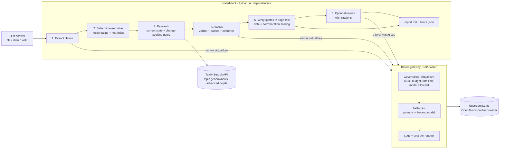

# Stale-Answer Detector

**Geek Room Global AI Hackathon 2026, challenge 05: Stale-answer detector (Track B, Tavily).** Built with **Bifrost by Maxim AI** and **Tavily**.

LLMs state facts about prices, API versions, laws and who runs a company with complete confidence, even after those facts have changed. This tool takes an LLM-generated answer, finds the claims that can go out of date, re-checks them against live web sources, and labels each claim **supported**, **changed** or **could not be verified**. Every label comes with a confidence indicator, the date of the newest evidence, and source links.

```
$ staledetect ask "Who is the CEO of X (Twitter), what is the latest stable Python version, and which Node.js release is the current Active LTS?"

--- answer from otari/meta/llama-3.1-8b-instruct ---
1. CEO of Twitter: Parag Agrawal (since November 2021)
2. Latest stable Python version: Python 3.9.9 (released on October 4, 2021)
3. Current Active LTS Node.js release: Node.js 14.17.0 (released on April 26, 2022)

3 claims, 3 re-checked: 0 supported, 3 changed, 0 unverifiable
  CHANGED  0.96  Parag Agrawal is the CEO of Twitter.  -> now: no longer CEO; removed by Elon Musk in 2022 ...
  CHANGED  0.91  The latest stable Python version is Python 3.9.9.  -> now: Python 3.15.1, released on October 21, 2026.
  CHANGED  1.00  Node.js 14.17.0 is the current Active LTS release. -> now: Node.js 24.x ..., Node.js 26 scheduled to become Active LTS on October 28, 2026.
Bifrost: 4 calls, 0 via fallback; Tavily: 5 searches
```

(Real output from 2 November 2026. The full report is in [`examples/run-ask-llama31-8b/`](examples/run-ask-llama31-8b/report.md).)

## What the challenge asks for, and where it is met

| Requirement (brief, challenge 05) | How this project meets it |
|---|---|
| Accept an LLM-generated answer and identify factual claims that may be time-sensitive | `staledetect check answer.md` (or `ask` to generate one). The **extract** step, run through Bifrost, splits the answer into atomic claims, each with a category and a time-sensitivity rating. A deterministic heuristic scorer (prices, versions, job titles, laws, "currently/latest", quantities, limits) backs it up, so a claim with a price or a CEO title is never skipped just because the model rated it low. Stable facts ("Python was created by Guido van Rossum") are listed as *not re-checked*. |
| Use live research to re-check selected claims against sources | Two **Tavily** searches per selected claim: one for the current state of the fact, and one *change-seeking* query that looks for news that it changed ("X steps down as CEO", "new version released"). The second query goes looking for disconfirming evidence, so the check isn't biased towards pages that repeat the old fact. Results are de-duplicated and sorted newest first. |
| Assign a freshness or confidence indicator to each claim, with source links | Each claim gets a 0–1 confidence and a high/medium/low level. The score combines the model's confidence with checks the code does itself: how many quotes were verified, how many independent sites agree, and how recent the newest evidence is (a date written inside the quote, like "As of January 2025", counts over the page date). It also records the newest evidence date and links each source. |
| Show which claims remain supported, have changed, or cannot be verified | Markdown, HTML and JSON reports with 🟢 supported / 🔴 changed (plus the current fact) / ⚪ unverifiable. `--rewrite` also produces a corrected answer with numbered citations. |
| "Clearly distinguish evidence from inference" (implementation note) | **Evidence** is only text quoted from a retrieved page, and every quote is checked against that page's text by code. Quotes that don't match are rejected and counted. **Inference** (the model's reasoning) is shown separately and labelled. If a "supported"/"changed" verdict has no verifiable quote, it is downgraded to "unverifiable". A "changed" verdict that adds no new fact, or that rests on a single website, is flagged or capped. |
| "Use Tavily for fresh web research and Bifrost for the model requests that extract, assess, or rewrite claims" | Exactly that split. All model calls (extract, assess, rewrite, and the `ask` answer) go through Bifrost. All research goes through Tavily. |

## Architecture



**What Bifrost does here (and why it matters for this product):**

- **One gateway for three model roles.** Extraction uses a cheap fast model (`qwen3-30b-a3b-instruct`). The harder judging step uses a stronger model (`qwen3-235b-a22b-instruct`). Each role has its own fallback chain. The app never talks to a provider directly.
- **Governance.** The app only holds a Bifrost *virtual key*. That key has a **$0.30 monthly budget**, a **300 requests/day and 400k tokens/day rate limit**, and a **model allow-list**. Bifrost enforces all of this before any provider is called (see [`examples/bifrost-governance-checks.md`](examples/bifrost-governance-checks.md): no key → 401 `virtual_key_required`, model outside the list → 403 `model_blocked`). A fact-checker that loops over many claims is exactly the kind of app that needs a hard spend ceiling.
- **Reliability.** Every request carries `fallbacks`. `--simulate-outage` routes the primary model to a provider entry whose upstream is down, and Bifrost answers from the fallback model. The report shows a warning, and `routing_info.is_fallback` is recorded per call ([`examples/run-outage/`](examples/run-outage/report.md)).
- **Observability and cost.** Pricing overrides give the self-hosted custom provider real per-token prices, so Bifrost's logs and the budget counter show actual spend. The CLI reads `/api/logs` and `/api/governance/virtual-keys` after each run and prints cost, errors and budget used.

**What Tavily does here:** Tavily is the only source of evidence. The detector calls `POST /search` with `search_depth: advanced` and `chunks_per_source: 3`, so it gets the relevant passages rather than whole pages. It uses `topic: news` with `time_range: year` for leadership, events and laws, and `topic: general` for docs and pricing. `include_answer` stays off, so the verdict is based on raw sources and not on a pre-written summary. Results are cached on disk (`.cache/tavily`) to save credits when re-running.

## Setup

Requirements: Python 3.10+, Node.js 18+ (for `npx`) or Docker, a Tavily API key (the free Researcher plan gives 1,000 credits a month), and an API key for any OpenAI-compatible LLM endpoint.

```bash
git clone https://github.com/ridakalam52-design/geekroom-stale-detector
cd geekroom-stale-detector
pip install -e ".[dev]"            # no runtime dependencies; pytest for tests
cp .env.example .env               # fill in TAVILY_API_KEY, OTARI_API_KEY, BIFROST_VK, BIFROST_SETUP_TOKEN

./scripts/run_bifrost.sh           # terminal 1: Bifrost on http://localhost:8080 (npx @maximhq/bifrost)
set -a; . ./.env; set +a           # terminal 2
staledetect doctor                 # checks the gateway, the virtual key and the Tavily key
staledetect check examples/sample_answer.md --rewrite --out runs/sample
open runs/sample/report.html
```

More commands:

```bash
staledetect ask "What does GitHub Copilot cost and who is the CEO of OpenAI?"   # answer with an older model, then check it
staledetect check answer.md --question "..." --max-claims 5                       # cap the live checks (cost control)
staledetect check answer.md --simulate-outage                                     # watch Bifrost fall back
cat answer.txt | staledetect check -                                              # stdin
python -m pytest -q                                                               # 26 offline tests
```

**Using another LLM provider.** [`bifrost/config.json`](bifrost/config.json) defines one OpenAI-compatible custom provider called `otari` (I used Mozilla's Otari gateway for open-weight models). To use OpenAI, Gemini, Anthropic, Groq or any other provider Bifrost supports, add it under `providers`, add it to the virtual key's `provider_configs`, and set `STALE_MODEL` / `STALE_ASSESS_MODEL` / `STALE_FALLBACKS` to `provider/model` names. `proxy_config: {"type": "environment"}` only makes Bifrost respect `HTTP(S)_PROXY` if your network has one. It does nothing otherwise.

## Sample runs (real, 2 November 2026)

| Run | What it shows |
|---|---|
| [`examples/run-sample/`](examples/run-sample/report.md) | A 9-claim answer written in the style of an assistant with an older knowledge cutoff. Result: **6 changed** (Python 3.12 → 3.15, Node 20 → 26 Active LTS, GPT-4o → GPT-6 Astra, Linda Yaccarino no longer CEO of X since July 2025, EU AI Act now adopted with obligations applying, Copilot moved to usage-based AI Credits), **1 supported** (Tavily free plan = 1,000 credits/month), **1 unverifiable** (an invented Pune startup: sources only describe other companies called Brightwave, so it is *not* marked "changed"), and **1 stable fact not re-checked**. Includes the corrected answer with 21 cited URLs. 11 Bifrost calls, ~$0.0045. |
| [`examples/run-ask-llama31-8b/`](examples/run-ask-llama31-8b/report.md) | `ask` mode. Llama 3.1 8B (through Bifrost) gives a 2021-era answer, and all 3 claims are flagged as changed with current facts. |
| [`examples/run-outage/`](examples/run-outage/report.md) | `--simulate-outage`: all 4 model calls were served by fallback models, and the report says so. |
| [`examples/bifrost-governance-checks.md`](examples/bifrost-governance-checks.md) | Virtual-key enforcement, model allow-list, fallback routing info, budget and rate-limit counters. |

Each run folder has `report.md` (readable), `report.html` (one self-contained page for the demo) and `report.json` (everything: claims, scores, sources, rejected quotes, gateway stats).

## How the confidence indicator is computed

```
verified quotes: 0 -> score 0 (no evidence, no confidence); 1 -> x0.75; 2+ -> x1.0
score = (0.45*model_confidence + 0.20*min(sites,3)/3 + 0.20*recency + 0.15) * quote_factor
recency: newest evidence <=90 days 1.0 | <=1y 0.8 | <=2y 0.55 | <=3y 0.35 | older 0.2 | undated 0.4
unverifiable -> 0.15.  high >= 0.75, medium >= 0.5, low < 0.5
```

Extra rules applied in code, not left to the model: a verdict with no verifiable quote is downgraded to unverifiable. "Changed" without a new fact is downgraded. A verdict that rests on a single website has its confidence capped at 0.6 with a note. "Changed" without a contradicting quote is capped at 0.5. Dates in the future ("supported until 2029") are ignored when computing evidence age.

## AI-use note

- **In the product:** LLMs (open-weight Qwen3, Mistral and Llama models, served through Bifrost) extract claims, judge each claim against retrieved sources, and optionally rewrite the answer. They never supply evidence: every quote is matched against the retrieved page text by deterministic code, and the reports separate evidence from the model's inference.
- **In building it:** I built this with help from an AI assistant (Hark), which drafted code, tests and documentation under my direction. I chose the challenge, reviewed the design and outputs, and ran the sample checks. All sample outputs in `examples/` come from real runs, not hand-edited.

## Limitations

- **Search coverage decides the verdict.** If Tavily doesn't surface the page that shows a change, the claim may come back "supported" or "unverifiable". The change-seeking second query reduces this but doesn't eliminate it. Repeated runs can differ when search results or model output differ.
- **Model judgment varies.** I saw run-to-run variation on nuanced claims, for example whether Copilot moving to usage-based billing while keeping a $10 base price counts as "changed". The code-level checks catch invented quotes and empty "changes", but not every bad reading of a real quote.
- **Low-quality sources.** Blogs and SEO pages can be wrong or describe a future that isn't real yet. The tool prefers official sources in its prompt and caps single-site verdicts, but it doesn't keep a domain trust list.
- **Dates.** Many pages have no publish date. Undated evidence gets a neutral recency score, and dates inside quotes are parsed with simple patterns.
- **Scope.** Built for short answers: at most 15 claims are extracted and 8 are re-checked by default (`--max-claims`). Answers are processed in English only. No UI beyond the CLI and the static HTML report.
- **Cost.** About $0.004–0.005 of model spend and 6–32 Tavily credits per 8-claim run. The Bifrost budget on the virtual key is the hard ceiling.

## Project layout

```
staledetect/        pipeline.py (steps), bifrost_client.py, tavily_client.py, heuristics.py,
                    evidence.py (quote verification, dates, scoring), prompts.py, report.py, cli.py
bifrost/config.json gateway config: provider, virtual key, budget, rate limit, allow-list, pricing, fallback test provider
scripts/            run_bifrost.sh
tests/              26 offline tests (fake gateway server, fake Tavily, pipeline, evidence rules)
examples/           sample answer and real run outputs
docs/               slide deck (PDF) and demo script
```

## License

MIT. See [LICENSE](LICENSE).
